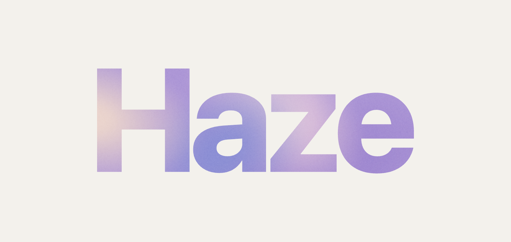
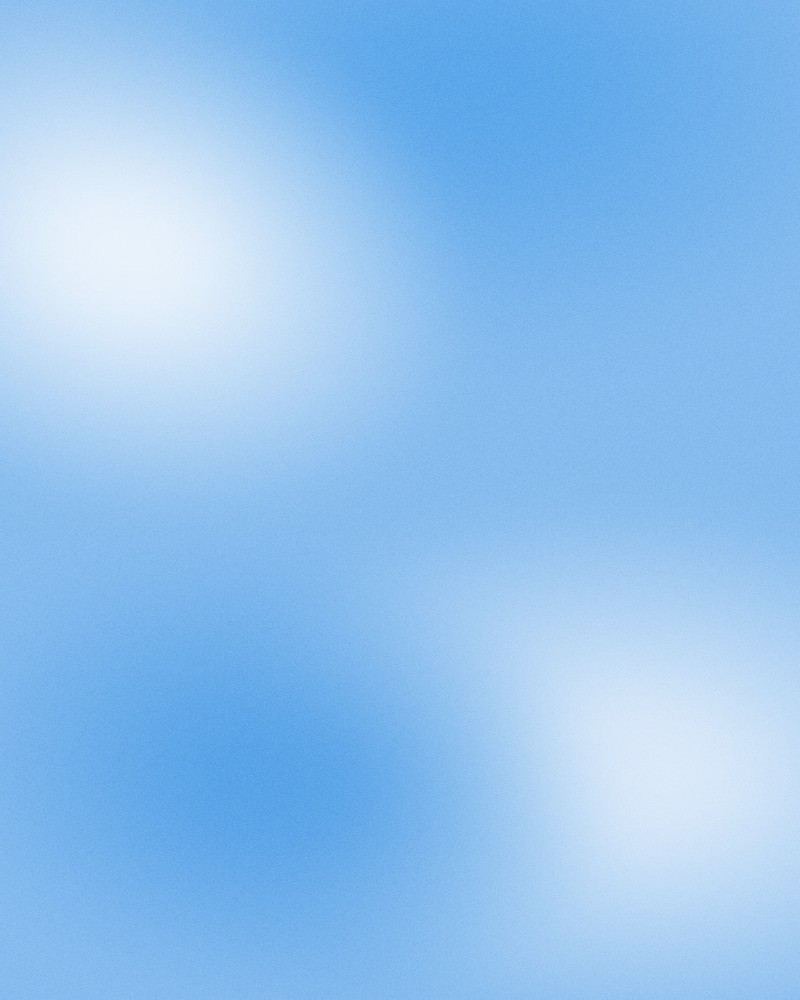
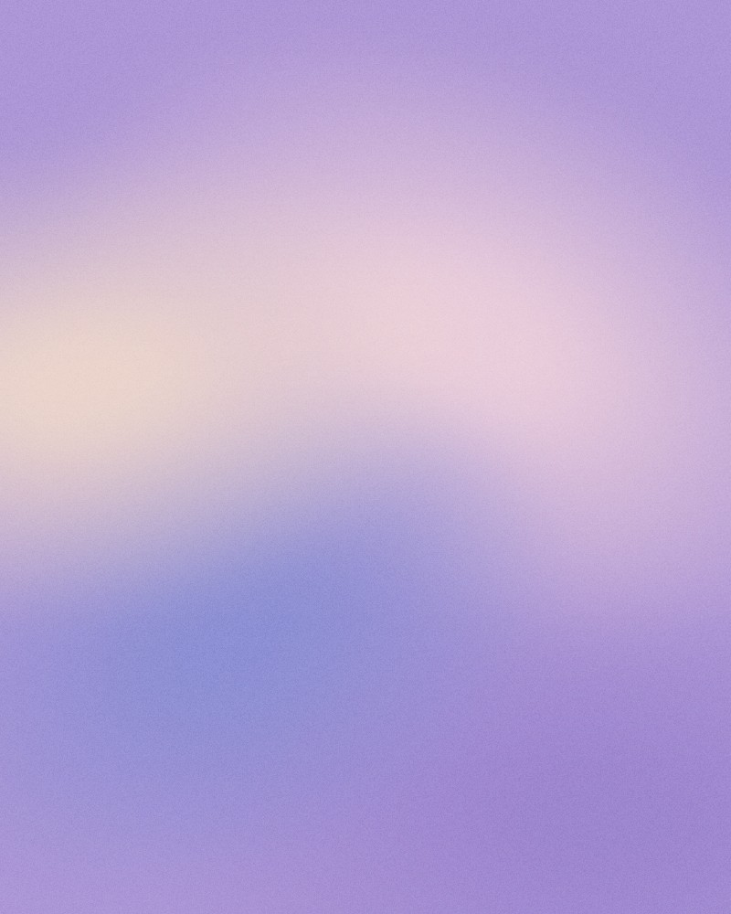
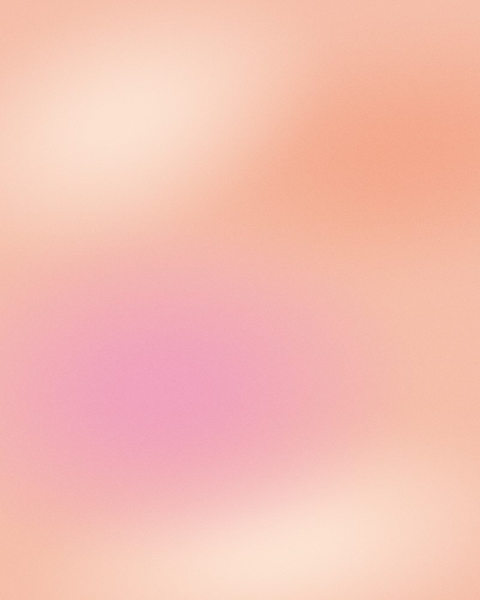
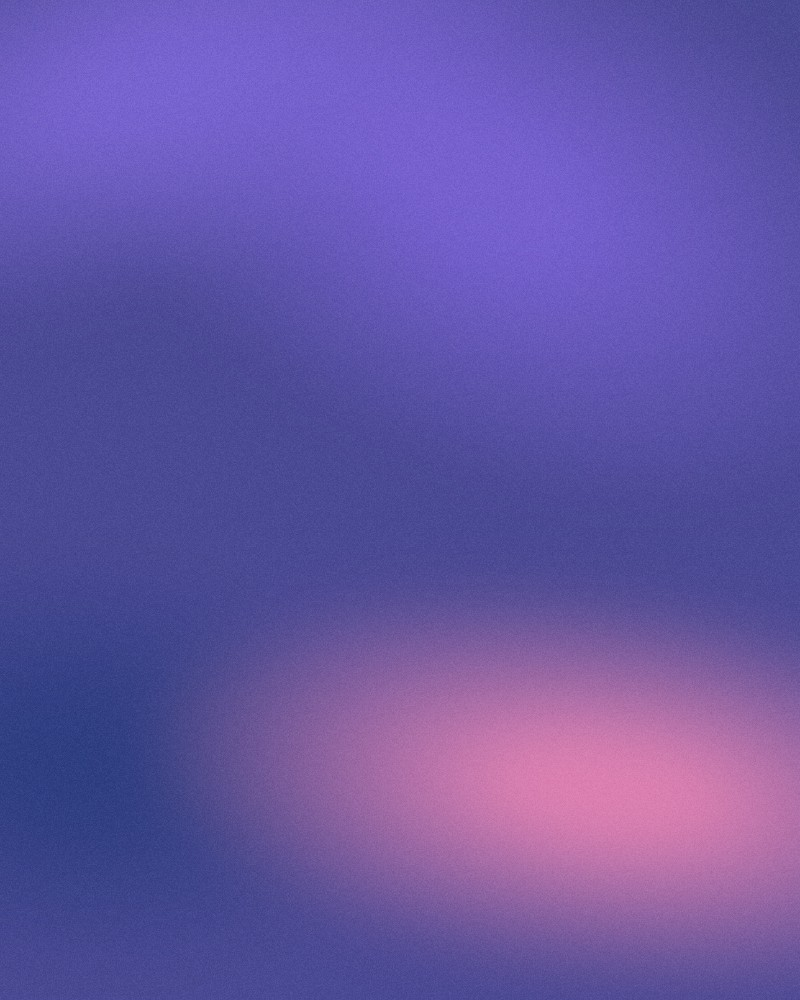

  

  <b>Soft, flowing gradients. Still or in motion.</b>  
  <a href="https://taliaren.github.io/haze/"><b>→ Open Haze in your browser</b></a> 
  taliaren.github.io/haze

---

Haze is a small browser tool for making soft, blurred gradient backgrounds (the kind often called *mesh*, *aura* or *grainy* gradients). Pick a mood, shape the colors right on the canvas, and download an image or a seamlessly looping video for wallpapers, slides and social posts.

No sign-up, no install. It runs entirely in your browser.

  
  
  
  

## Features

- **Start from a mood.** Sky, Lavender, Sage, Grass, Sunset and Dusk, or a blank canvas.
- **Shape it on the canvas.** Drag a dot to move a shape. Use its handles to resize, rotate and stretch it.
- **Colors that fit.** Every color picker suggests six colors that match the rest of your picture, or you can pick your own.
- **Recolor.** Keep the layout you love and try a whole new palette. Hover to preview, click to apply.
- **Still or Motion.** In Motion, shapes drift slowly in a loop that repeats seamlessly.
- **Any size.** 9:16, 3:4, 4:5, 1:1, 4:3, 16:9 or a custom size.
- **Export.** PNG, JPG and WebP images, or MP4 and WebM video loops.
- **Autosave.** Your last design stays in your browser, ready to continue.

## Keyboard shortcuts

| Key | Action |
| --- | --- |
| `R` | Shuffle layout |
| `C` | Shuffle colors between shapes |
| `P` | Open Recolor |
| `M` | Switch between Still and Motion |
| `H` | Hide or show the on-canvas controls |
| `Delete` | Delete the selected shape |
| Arrow keys | Nudge the selected shape (hold `Shift` for bigger steps) |
| `⌘Z` / `⇧⌘Z` | Undo / redo |

## How it works

- Each shape is a soft radial gradient painted on a small canvas, blurred, then scaled up, which keeps rendering fast at any export size.
- A fixed grain texture is laid on top with a soft-light blend, so motion never flickers.
- Motion paths use whole-number frequencies, so the first and last frame of a loop match exactly.
- Video is recorded in real time with the browser's `MediaRecorder`.
- Color suggestions stay inside the hues, saturation and lightness already in your picture.

## Browser support

Works in the latest Chrome, Edge, Safari and Firefox. Video export depends on the browser: MP4 in Chrome and Safari, WebM in Chrome and Firefox. The eyedropper is available in Chrome and Edge.
